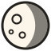
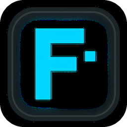
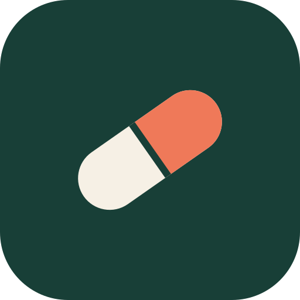

<p align="center">
  
</p>

<h1 align="center">Tiny Moon Labs — The Hub</h1>

<p align="center">
  Todos los productos del Lab, en un solo lugar.<br>
  <a href="https://tinymoonlabs.com">tinymoonlabs.com</a> · <a href="https://tml.uy">tml.uy</a> · <a href="https://tml.com.uy">tml.com.uy</a>
</p>

---

Tiny Moon Labs es un laboratorio chico, en Montevideo, que construye productos de software y los publica abiertos para que cualquiera los use. Cada producto vive en su propio repositorio; este hub los reúne: los lista acá abajo y los incluye como submódulos en [`productos/`](productos). Los proyectos que todavía son demos van aparte, en [`taller/`](taller).

## Productos

| | Producto | Qué es | Código | Sitio |
|:-:|---|---|---|---|
|  | **Friday** | Un asistente personal que trabaja de día y de noche sobre Claude Code y te habla por Telegram. | [friday-showcase](https://github.com/missingus3r/friday-showcase) | [Conocer a Friday](https://missingus3r.github.io/friday-showcase/) |
|  | **Capsule** | Una red libre y descentralizada para mandar archivos y publicar sitios, sin cuenta y sin pedir permiso. | [CAPSULE](https://github.com/missingus3r/CAPSULE) | [Conocer Capsule](https://missingus3r.github.io/CAPSULE/) |
|  | **AA Tube** | YouTube en la pantalla de Android Auto, con tu cuenta, para usar con el auto estacionado. | [aa-tube](https://github.com/missingus3r/aa-tube) | — |
|  | **AA Disney** | Disney+ en la pantalla de Android Auto, con tu cuenta, para usar con el auto estacionado. | [aa-disney](https://github.com/missingus3r/aa-disney) | — |

## En el taller

Demos y posibles proyectos futuros: se pueden probar, pero todavía no son productos.

| | Proyecto | Qué es | Código | Sitio |
|:-:|---|---|---|---|
|  | **Archivo en vidrio** | Demo 3D de un grabador DIY que escribe datos dentro de vidrio con un láser y los lee con una cámara, inspirado en Microsoft Project Silica. | [archivo-en-vidrio](https://github.com/missingus3r/archivo-en-vidrio) | [Ver el proyecto](https://tinymoonlabs.com/vidrio.html) · [Demo](https://tinymoonlabs.com/grabador-5d/) |

## Clonar todo junto

```bash
git clone --recurse-submodules https://github.com/missingus3r/tml-the-hub.git
```

Si ya lo clonaste sin los submódulos:

```bash
git submodule update --init
```

Para traer la última versión de cada producto:

```bash
git submodule update --remote
```

## Sumar un producto

1. Agregarlo como submódulo: `git submodule add https://github.com/missingus3r/<repo>.git productos/<nombre>`
   (o en `taller/<nombre>` si todavía es una demo).
2. Poner su logo en `assets/` y sumar una fila a la tabla de **Productos** (o de **En el taller**).
3. Commit y push.
